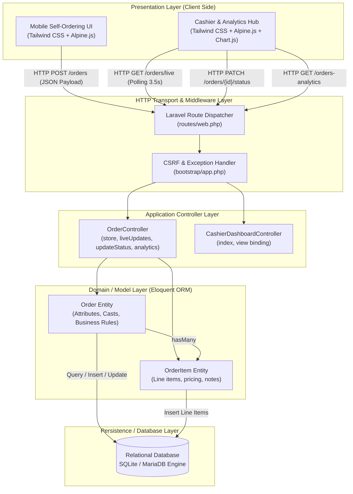
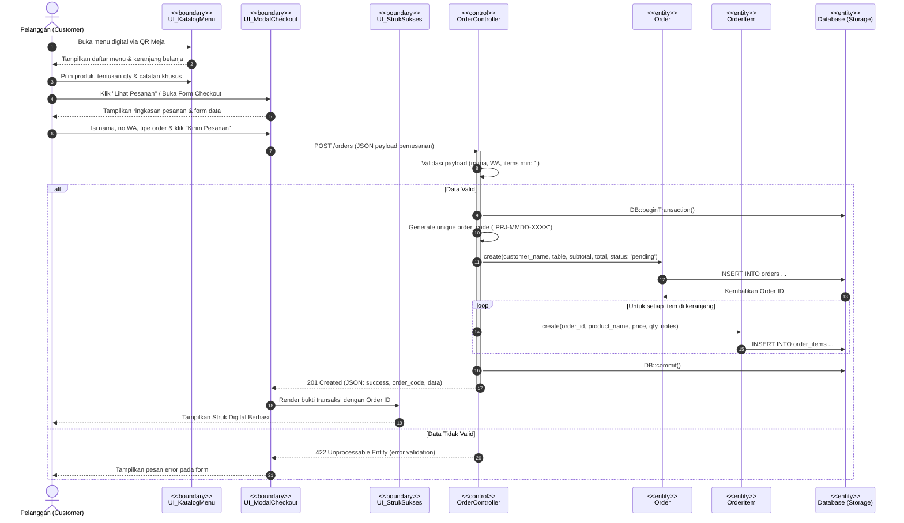
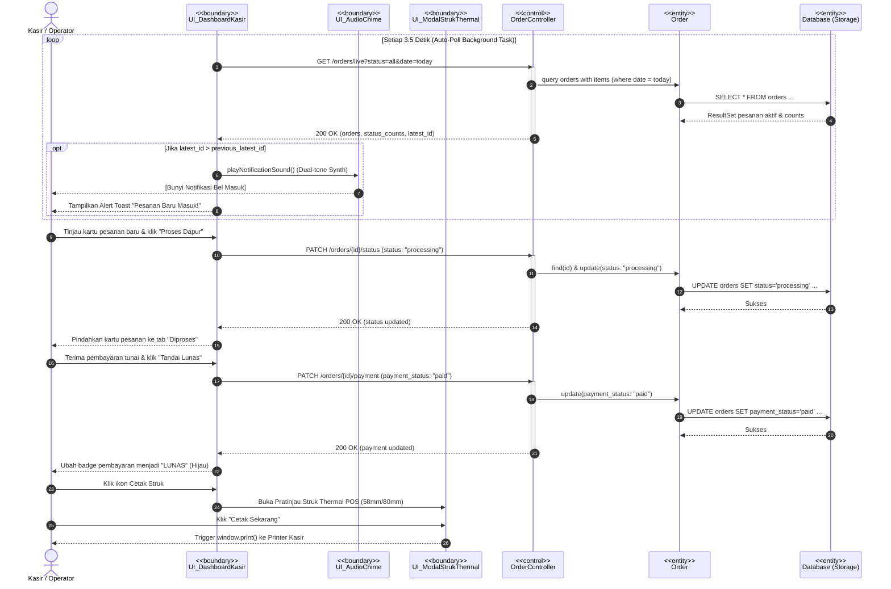
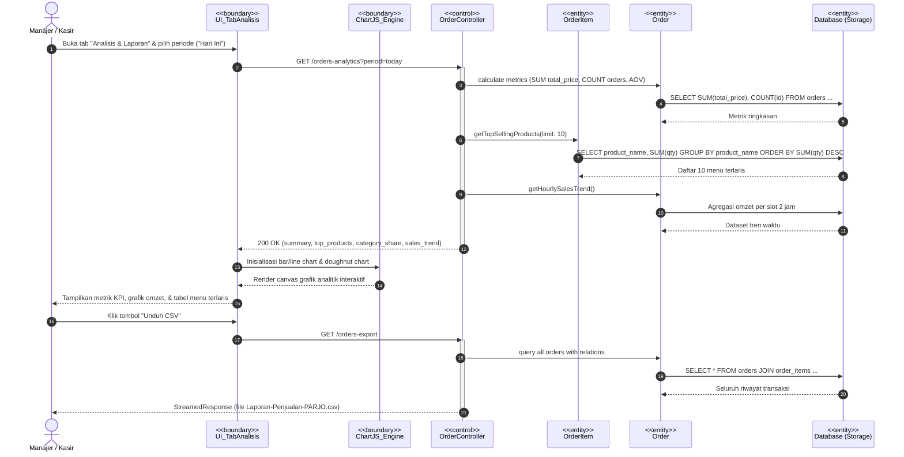
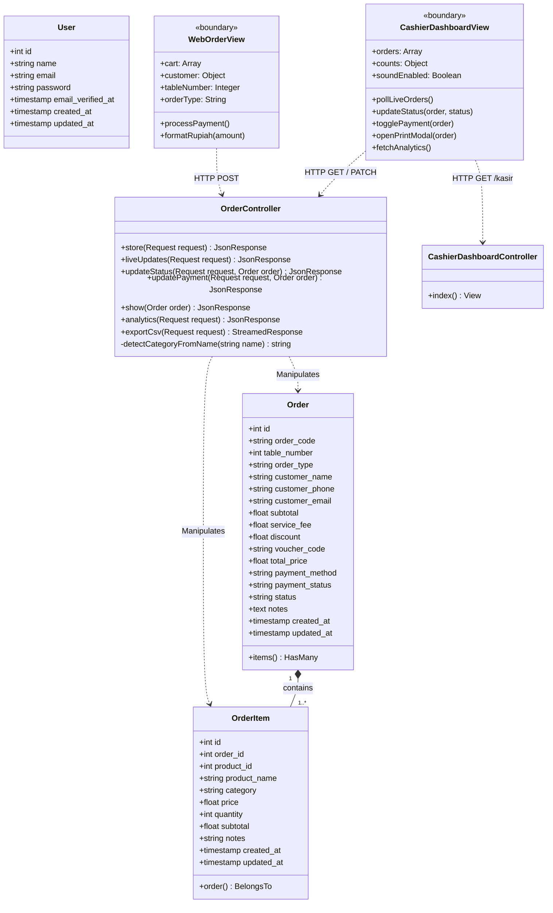
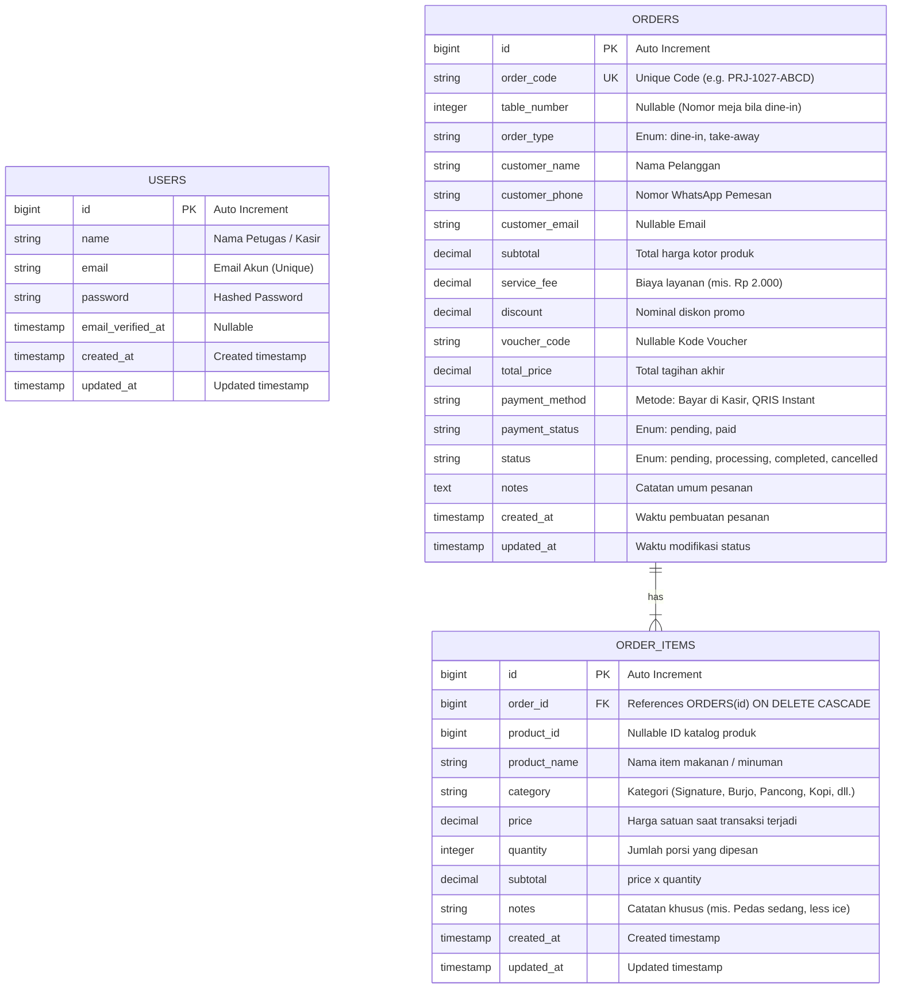
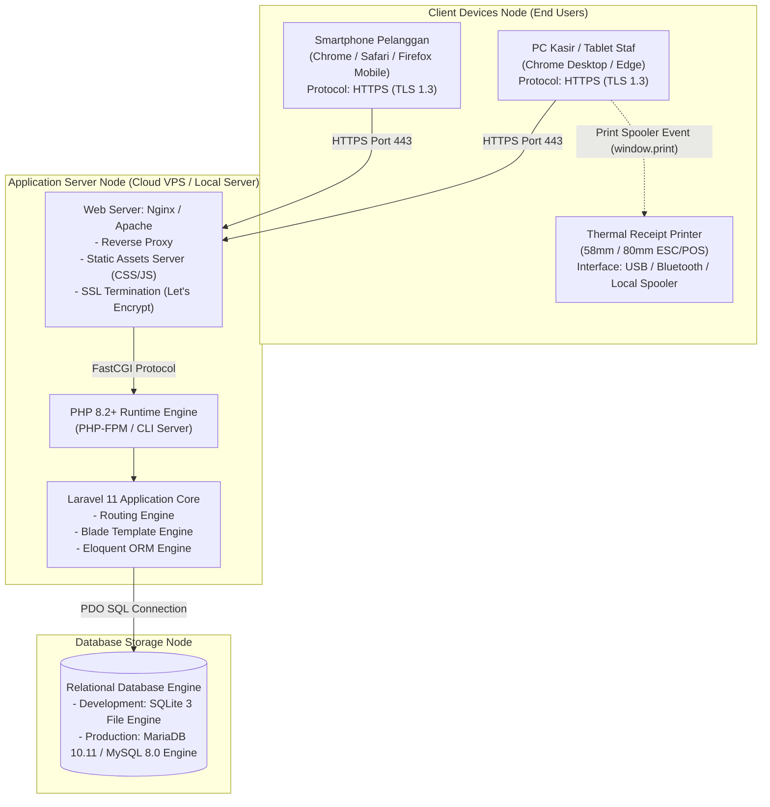

# DOKUMENTASI DESAIN PERANCANGAN PERANGKAT LUNAK (PPL)
## SISTEM SELF-ORDERING & DASHBOARD KASIR "PARJO" (PANCONG & BURJO)

Dokumen ini memuat seluruh perancangan arsitektur, realisasi proses bisnis (Sequence Diagram BCE), desain basis data (Class Diagram & ERD), verifikasi normalisasi, desain UI/UX, serta arsitektur fisik (Deployment Diagram) untuk sistem web pemesanan dan kasir **PARJO**.

---

## A.1 Desain Arsitektur Perangkat Lunak

### Pola Arsitektur yang Dipilih:
**Model-View-Controller (MVC) Monolitik Modular (Modular Monolith / Layered Architecture)**

### Alasan Pemilihan:
1. **Karakteristik & Skala Proyek Capstone (Rujukan Modul 5 Bagian 3.4)**:  
   Sistem PARJO dirancang untuk operasional restoran/warmindo dengan skala *single-store* hingga beberapa cabang mandiri. Pada skala ini, arsitektur monolitik modular merupakan pilihan paling optimal karena menghindari kompleksitas berlebih (*overhead*) dari *Microservices*, seperti latensi jaringan antar-layanan (*network latency*), konsistensi terdistribusi (*distributed transactions*), dan kebutuhan orkestrasi kontainer rumit (Kubernetes/Service Mesh).
2. **Integritas Transaksi & Data Tunggal (*Single Source of Truth*)**:  
   Pemesanan dari meja pelanggan (*self-ordering*) dan pengelolaan pesanan oleh kasir mengakses basis data relasional yang sama secara terpusat. Hal ini menjamin konsistensi data instan (*ACID compliant*), mencegah duplikasi nomor meja, serta memastikan pembaruan status pesanan langsung tersinkronisasi tanpa dependensi *event broker* terdistribusi.
3. **Kohesi Tinggi dan Kopling Rendah (*High Cohesion, Low Coupling*)**:  
   Arsitektur MVC Laravel memisahkan tanggung jawab sistem secara tegas:
   * **Presentation Layer (View)**: Menggunakan Blade template yang dipadukan dengan Alpine.js untuk reaktivitas sisi klien dan Tailwind CSS untuk styling modular.
   * **Application / Logic Layer (Controller)**: Menangani validasi request, alur bisnis pemesanan, agregasi statistik analitik, dan format stream data CSV.
   * **Domain / Persistence Layer (Model)**: Menggunakan Eloquent ORM untuk memodelkan entitas bisnis (`Order`, `OrderItem`, `User`) dan relasinya.
4. **Efisiensi Pengujian dan Pemeliharaan**:  
   Seluruh siklus aplikasi dapat diuji secara menyeluruh (*end-to-end*) di lingkungan lokal maupun staging dengan konfigurasi dependensi tunggal.

### Diagram Arsitektur Perangkat Lunak:

---

## A.2 Realisasi Proses Bisnis: Sequence Diagram Kunci (Pola BCE)

Setiap objek dalam Sequence Diagram diklasifikasikan menggunakan pola **Boundary / Control / Entity (BCE)** sesuai panduan Modul 5 Bagian 4:
* **Boundary (`<<boundary>>`)**: Komponen antarmuka pengguna (halaman web, modal, popup notifikasi).
* **Control (`<<control>>`)**: Komponen pengontrol logika bisnis (`OrderController`).
* **Entity (`<<entity>>`)**: Komponen data bisnis (`Order`, `OrderItem`, Database).

---

### Sequence Diagram 1: Use Case Pemesanan Mandiri oleh Pelanggan (Customer Self-Ordering & Checkout)

**Deskripsi Alur**: Pelanggan memilih menu makanan/minuman dari antarmuka digital di smartphone, memasukkan data diri dan nomor meja, kemudian sistem memvalidasi dan mencatat pesanan ke dalam basis data melalui transaksi atomik.

---

### Sequence Diagram 2: Use Case Pemrosesan & Pembaruan Status Pesanan oleh Kasir (Live Order Polling, Kitchen Processing & Settlement)

**Deskripsi Alur**: Dashboard kasir melakukan pemantauan berkala (*auto-polling*), menerima pesanan baru secara real-time disertai audio chime, mengubah status pesanan ke tahap dapur, mencatat status pembayaran lunas, dan mencetak struk thermal POS.

---

### Sequence Diagram 3: Use Case Analisis Bisnis & Ekspor Laporan Penjualan (Business Analytics)

**Deskripsi Alur**: Kasir/manajer membuka tab analitik, sistem mengagregasi data penjualan berdasarkan periode terpilih, merender grafik visual tren dan distribusi pembayaran, serta mengunduh berkas laporan CSV.

---

## A.3 Desain Basis Data (Class Diagram dan ERD)

### Class Diagram

Class diagram menggambarkan struktur kelas logika pengendali (*Controller*), representasi entitas data (*Entity Eloquent Models*), serta antarmuka (*Boundary Views*).

---

### Entity-Relationship Diagram (ERD)

---

### Spesifikasi Skema Tabel

#### 1. Tabel: `orders`
Menyimpan data induk setiap transaksi pemesanan yang dilakukan pelanggan atau diinput langsung oleh kasir.

| Nama Kolom | Tipe Data | Constraint | Keterangan Singkat |
| :--- | :--- | :--- | :--- |
| `id` | `BIGINT UNSIGNED` | `PK, AUTO_INCREMENT` | Identifikator unik pesanan (Internal ID) |
| `order_code` | `VARCHAR(50)` | `UNIQUE, NOT NULL` | Kode referensi pesanan ramah pengguna (mis. `PRJ-1027-4A2B`) |
| `table_number` | `INTEGER` | `NULLABLE` | Nomor meja pelanggan (bernilai NULL jika Take-Away) |
| `order_type` | `VARCHAR(20)` | `DEFAULT 'dine-in'` | Tipe pesanan: `dine-in` (Makan di Meja) atau `take-away` |
| `customer_name` | `VARCHAR(100)` | `NOT NULL` | Nama lengkap atau panggilan pemesan |
| `customer_phone` | `VARCHAR(30)` | `NOT NULL` | Nomor kontak WhatsApp pemesan untuk konfirmasi pesanan |
| `customer_email` | `VARCHAR(100)` | `NULLABLE` | Alamat surel pemesan (opsional untuk struk digital) |
| `subtotal` | `DECIMAL(12,2)` | `DEFAULT 0.00` | Akumulasi harga seluruh produk sebelum biaya dan diskon |
| `service_fee` | `DECIMAL(12,2)` | `DEFAULT 0.00` | Biaya layanan sistem restoran (mis. Rp 2.000) |
| `discount` | `DECIMAL(12,2)` | `DEFAULT 0.00` | Potongan harga dari voucher promo |
| `voucher_code` | `VARCHAR(50)` | `NULLABLE` | Kode voucher promo yang digunakan |
| `total_price` | `DECIMAL(12,2)` | `DEFAULT 0.00` | Total nominal final yang wajib dibayarkan pelanggan |
| `payment_method` | `VARCHAR(50)` | `NOT NULL` | Metode bayar: `Bayar di Kasir` atau `QRIS Instant` |
| `payment_status` | `VARCHAR(20)` | `DEFAULT 'pending'` | Status pembayaran: `pending` (Belum Lunas) atau `paid` (Lunas) |
| `status` | `VARCHAR(20)` | `DEFAULT 'pending'` | Alur operasional: `pending`, `processing`, `completed`, `cancelled` |
| `notes` | `TEXT` | `NULLABLE` | Catatan keseluruhan pesanan dari tamu |
| `created_at` | `TIMESTAMP` | `NULLABLE` | Waktu transaksi dibuat |
| `updated_at` | `TIMESTAMP` | `NULLABLE` | Waktu status terakhir diperbarui |

---

#### 2. Tabel: `order_items`
Menyimpan rincian item (menu makanan/minuman) dari setiap pesanan.

| Nama Kolom | Tipe Data | Constraint | Keterangan Singkat |
| :--- | :--- | :--- | :--- |
| `id` | `BIGINT UNSIGNED` | `PK, AUTO_INCREMENT` | Identifikator unik baris item |
| `order_id` | `BIGINT UNSIGNED` | `FK, NOT NULL` | Relasi ke `orders(id)` dengan opsi *ON DELETE CASCADE* |
| `product_id` | `BIGINT UNSIGNED` | `NULLABLE` | ID referensi katalog menu produk |
| `product_name` | `VARCHAR(150)` | `NOT NULL` | Nama menu saat dibeli (mis. *Nasi Ayam Kuah Laos*) |
| `category` | `VARCHAR(50)` | `NULLABLE` | Kategori menu (Signature, Burjo, Pancong, Kopi, Tea, dll.) |
| `price` | `DECIMAL(12,2)` | `NOT NULL` | Harga satuan produk pada saat transaksi terjadi |
| `quantity` | `INTEGER` | `NOT NULL, DEFAULT 1`| Kuantitas/jumlah porsi yang dipesan |
| `subtotal` | `DECIMAL(12,2)` | `NOT NULL` | Nilai subtotal item (`price` dikali `quantity`) |
| `notes` | `VARCHAR(255)` | `NULLABLE` | Catatan khusus per menu (mis. *Pedas sedang, less ice*) |
| `created_at` | `TIMESTAMP` | `NULLABLE` | Waktu baris data dibuat |
| `updated_at` | `TIMESTAMP` | `NULLABLE` | Waktu baris data dimodifikasi |

---

#### 3. Tabel: `users`
Menyimpan kredensial otentikasi kasir/staf pengelola sistem.

| Nama Kolom | Tipe Data | Constraint | Keterangan Singkat |
| :--- | :--- | :--- | :--- |
| `id` | `BIGINT UNSIGNED` | `PK, AUTO_INCREMENT` | Identifikator unik pengguna/kasir |
| `name` | `VARCHAR(255)` | `NOT NULL` | Nama operator kasir / admin |
| `email` | `VARCHAR(255)` | `UNIQUE, NOT NULL` | Alamat email untuk login sistem |
| `password` | `VARCHAR(255)` | `NOT NULL` | Kata sandi terenkripsi (Bcrypt hash) |
| `email_verified_at` | `TIMESTAMP` | `NULLABLE` | Waktu verifikasi email |
| `created_at` | `TIMESTAMP` | `NULLABLE` | Waktu akun didaftarkan |
| `updated_at` | `TIMESTAMP` | `NULLABLE` | Waktu akun diperbarui |

---

### Verifikasi Normalisasi (1NF, 2NF, 3NF)

Tim telah melakukan verifikasi normalisasi terhadap skema basis data di atas:

1. **Bentuk Normal Pertama (1NF)**:
   * **Terpenuhi**. Setiap sel data pada tabel `orders`, `order_items`, dan `users` bernilai tunggal (*atomic value*). Tidak terdapat atribut bernilai ganda (*multi-valued attributes*) maupun kelompok berulang (*repeating groups*). Item menu pesanan yang berulang telah dipisahkan ke tabel tersendiri (`order_items`). Setiap baris diidentifikasi oleh Primary Key yang unik.
2. **Bentuk Normal Kedua (2NF)**:
   * **Terpenuhi**. Skema berada dalam 1NF dan seluruh atribut non-key bergantung penuh secara fungsional (*fully functional dependency*) pada Primary Key masing-masing tabel. Pada tabel `order_items`, seluruh atribut seperti `product_name`, `price`, `quantity`, dan `subtotal` bergantung pada `id` (PK tunggal), bukan pada sebagian kunci (*tidak ada partial dependency*).
3. **Bentuk Normal Ketiga (3NF) & Alasan Denormalisasi Terkendali**:
   * **Terpenuhi secara terukur**. Skema berada dalam 2NF dan tidak mengandung ketergantungan transitif (*transitive dependency*) antar atribut non-key.
   * **Penjelasan Denormalisasi Terkendali (*Controlled Denormalization*)**:
     Pada tabel `order_items`, kolom `product_name`, `category`, dan `price` sengaja disimpan secara langsung (bukan hanya mereferensikan `product_id`). Hal ini merupakan praktik standar dalam rekayasa sistem POS (*Point of Sale*) dan *e-commerce*:
     > **Alasan Bisnis & Integritas Keuangan**: Harga menu restoran bersifat dinamis (dapat naik atau turun di masa mendatang). Jika harga hanya diambil melalui join ke tabel produk, maka perubahan harga di masa depan akan secara keliru mengubah histori pendapatan dan struk transaksi lama. Menyimpan *historical snapshot* harga dan nama menu di `order_items` menjamin akurasi laporan keuangan dan audit legalitas struk kasir sepanjang waktu.

---

## A.4 Desain Antarmuka Pengguna (UI/UX)

### Ringkasan Pendekatan Desain:
* **Mobile-First Responsive**: Sisi pemesanan mandiri pelanggan dirancang khusus berorientasi perangkat smartphone (*viewport container* maksimal 480px di desktop) agar identik dengan pengalaman aplikasi *native self-ordering* bergaya ESB Order.
* **Continuous Scroll & Real-Time Scrollspy**: Navigasi kategori dinamis (*Signature, Burjo & Nasi, Indomie, Pancong, Kopi, Tea*) yang otomatis menggeser layar secara halus (*smooth scroll*) dan menyorot tab aktif berdasarkan posisi scroll pengguna.
* **Tactile Feedback & Visual Hierarchy**: Mengusung estetika visual modern brutalist hangat khas kultur Warmindo (palet warna Oranye `#FF4800`, Hijau Botol `#00583E`, dan Kuning `#EEFD37`) dengan bayangan tegas (*hard shadows*) dan tipografi *Plus Jakarta Sans* yang mudah dibaca.
* **Desktop Operations Hub (Kasir)**: Antarmuka kasir dirancang melebar untuk layar desktop/tablet kasir, memadukan kartu antrean pesanan real-time, tombol aksi status cepat, pratinjau struk thermal 58mm/80mm, serta visualisasi grafik analitik bisnis interaktif.

### Contoh Layar Kunci (Key Screens):

1. **Layar Kunci 1: Mobile Self-Ordering Catalog & Floating Basket**  
   Menampilkan identitas meja (`MEJA #05`), banner promo produk andalan, scroll bar kategori, kartu produk dengan foto asli, badge status (*Favorite/Lumer*), stepper porsi, serta *sticky bottom action bar* yang memperlihatkan akumulasi belanja pelanggan secara real-time.
2. **Layar Kunci 2: Review Pesanan, Pilihan Metode Bayar & Struk Sukses**  
   Menampilkan pemilih tipe pesanan (*Makan di Meja vs Take Away*), isian nama dan nomor kontak WhatsApp, perincian subtotal dan biaya layanan, opsi metode bayar (*QRIS Instant vs Kasir*), serta modal sukses pemesanan berformat struk digital ESB dengan kode pesanan unik.
3. **Layar Kunci 3: Dashboard Kasir Real-Time & Business Analytics Hub**  
   Menampilkan kartu metrik KPI harian (*Menunggu, Diproses, Selesai, Omzet*), grid pesanan aktif dengan indikator live-polling 3.5 detik, tombol pembaruan status dapur dan pembayaran lunas, cetak struk thermal POS, serta panel visual grafik tren omzet dan tabel *Top 10 Menu Terlaris*.

> **Tautan Berkas Prototipe Interaktif & File Figma Ready**:  
> Seluruh template HTML statis yang siap di-import langsung menjadi komponen vektor dan frame Figma dapat diakses di repositori GitHub proyek:  
> 🔗 `https://github.com/Fadhilah05-afk/PPL/tree/main/figma_templates`  
> * [web_order_ui.html](https://github.com/Fadhilah05-afk/PPL/blob/main/figma_templates/web_order_ui.html) *(3 Frame Mobile: Katalog, Checkout, Struk Digital)*  
> * [kasir_dashboard_ui.html](https://github.com/Fadhilah05-afk/PPL/blob/main/figma_templates/kasir_dashboard_ui.html) *(Desktop Frame: Dashboard Kasir, Analitik Bisnis & Struk Thermal POS)*

---

## A.5 Desain Arsitektur Fisik (Deployment Diagram)

### Diagram Fisik Arsitektur Sistem:

### Rencana Teknologi Hosting & Deployment Implementasi:
* **Infrastruktur Server**: Cloud VPS (Virtual Private Server) berbasis Linux Ubuntu 22.04 / 24.04 LTS (misalnya DigitalOcean, Linode, atau penyedia lokal seperti IDCloudHost).
* **Web Server & Reverse Proxy**: **Nginx** dikonfigurasi dengan HTTP/2 dan Gzip/Brotli compression untuk mempercepat *loading time* aset mobile.
* **Sertifikat Keamanan**: SSL/TLS gratis otomatis menggunakan **Certbot (Let's Encrypt)** untuk mengamankan seluruh transmisi data transaksi dan enkripsi kata sandi.
* **Aplikasi & Runtime**: **PHP 8.2-FPM** yang dioptimalkan dengan OPcache aktif, Composer autoloader teroptimasi (`composer install --optimize-autoloader --no-dev`), dan cache konfigurasi Laravel (`php artisan config:cache`, `php artisan route:cache`, `php artisan view:cache`).
* **Basis Data Produksi**: **MariaDB 10.11+** atau **SQLite 3** dengan mode WAL (*Write-Ahead Logging*) untuk performa konkurensi baca/tulis yang tinggi pada jam-jam sibuk restoran.
