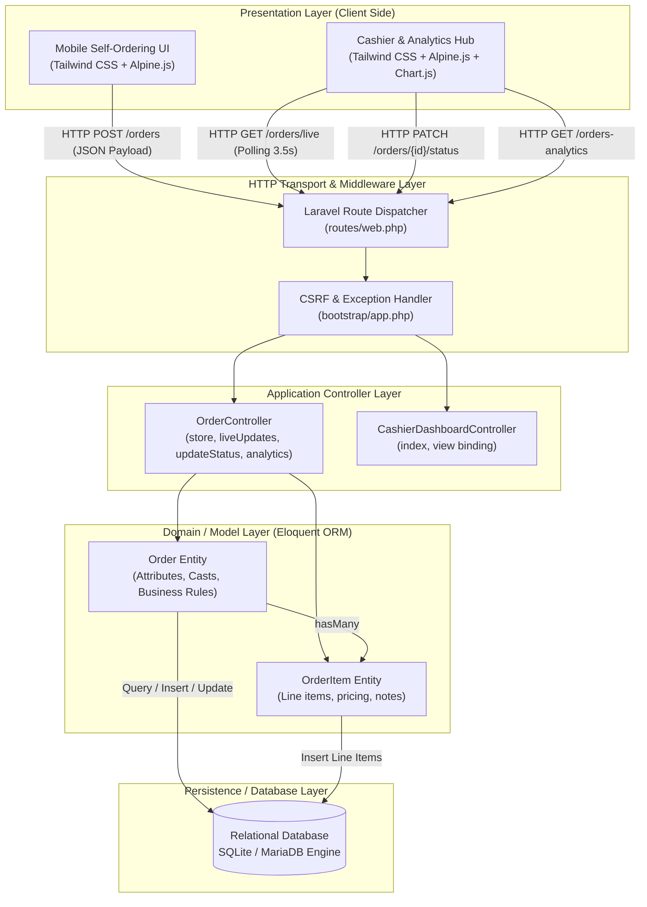
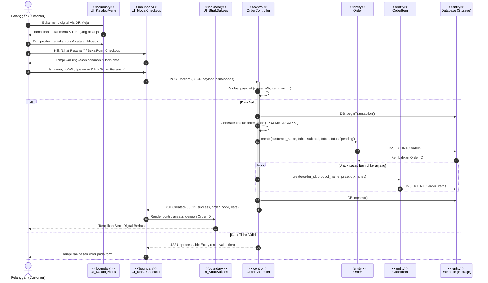
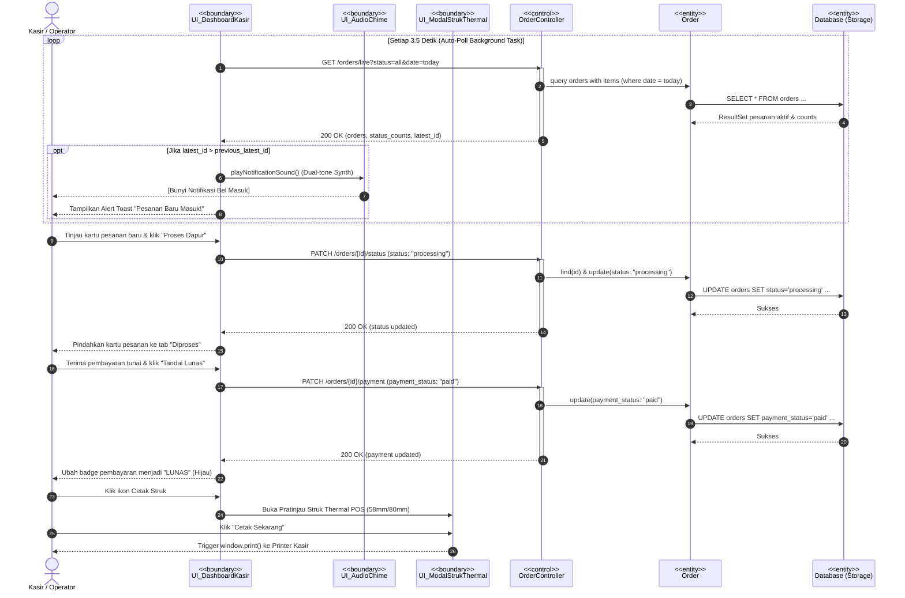
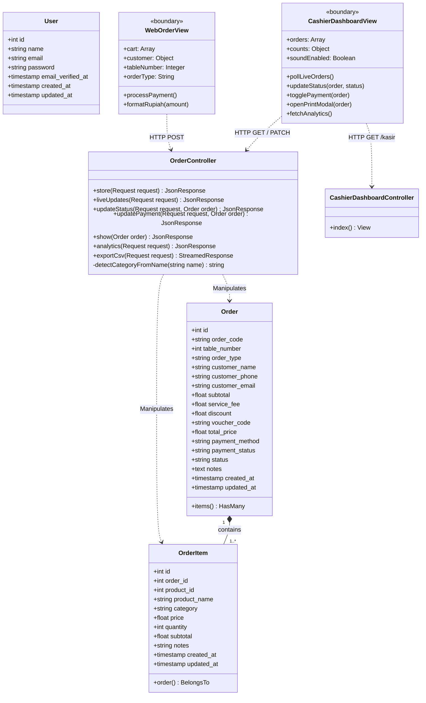
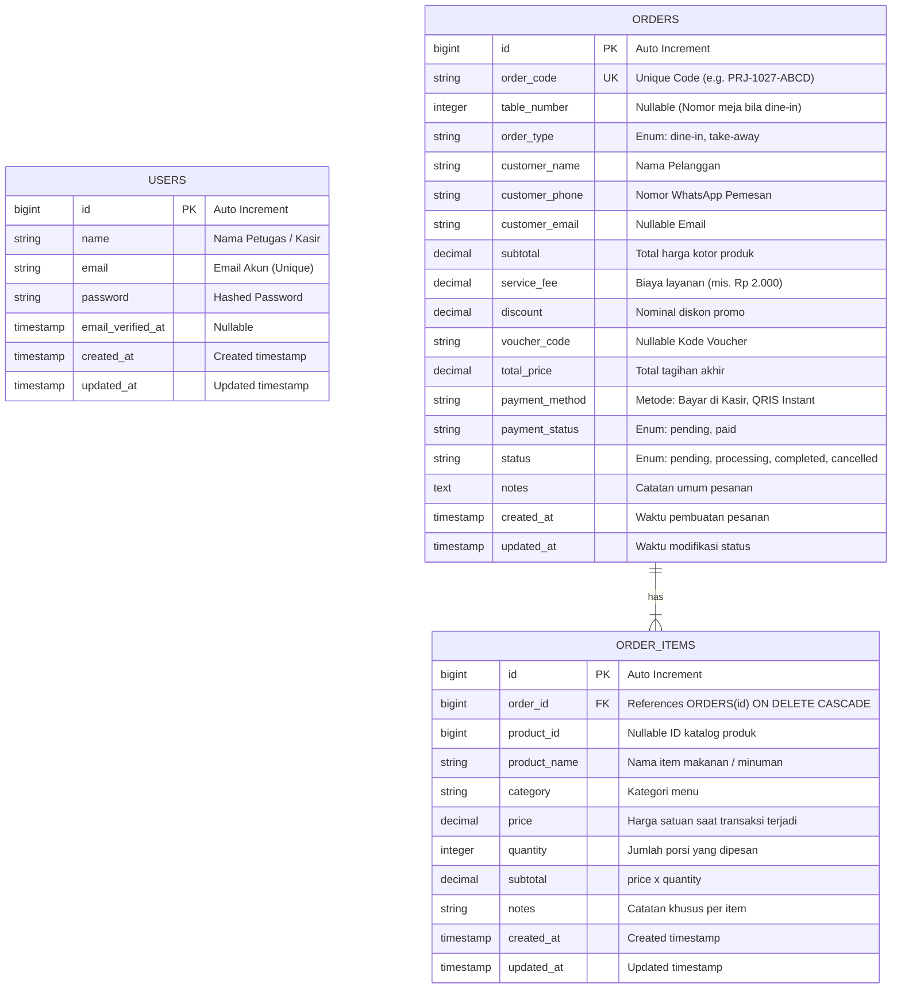
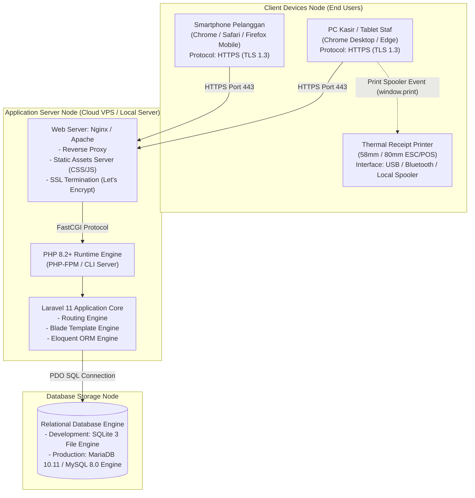

# DESIGN SPECIFICATION DOCUMENT (`design.md`)
# PARJO - Self-Ordering System & Cashier Operations Hub

> **Proyek**: Tugas Kelompok Pengembangan Perangkat Lunak (PPL)  
> **Aplikasi**: PARJO (Pancong & Burjo) — Digital Ordering & Cashier Analytics Hub  
> **Versi**: 2.0.0  
> **Tanggal**: 27 Oktober 2026  
> **Status**: Selesai Diimplementasikan & Teruji  

---

## 1. Ikhtisar Proyek (Project Overview)

**PARJO (Pancong & Burjo)** adalah aplikasi web terintegrasi yang menggabungkan:
1. **Customer Self-Ordering System**: Antarmuka pemesanan mandiri ramah seluler (*mobile-first*) yang memungkinkan pelanggan memindai kode QR di meja, menelusuri menu dengan navigasi continuous scroll & scrollspy, memilih varian/catatan kustom, dan melakukan checkout digital (QRIS Instant atau Bayar di Kasir).
2. **Cashier Operations Hub & POS**: Dashboard kasir real-time dengan sinkronisasi otomatis (*auto-polling* setiap 3.5 detik), notifikasi suara audio chime bawaan, kontrol alur pesanan (*Pending ➔ Processing ➔ Completed*), validasi pembayaran kasir, input order walk-in, dan pencetakan struk thermal POS 58mm/80mm.
3. **Business Intelligence & Analytics**: Modul analitik pendapatan yang menyajikan grafik tren penjualan berkala (harian dan per jam), metrik AOV (*Average Order Value*), matriks menu terlaris (*Top 10 Best Sellers*), kontribusi kategori, serta fitur ekspor laporan penjualan ke format CSV/Excel.

---

## 2. Sistem Desain UI/UX (Design System)

### 2.1 Palet Warna (Color Palette)

Identitas visual PARJO memadukan estetika *modern neo-brutalist* hangat yang mencerminkan kultur kuliner Warmindo & Burjo dengan presisi visual modern:

| Nama Token | Kode HEX | Peran & Penggunaan |
| :--- | :--- | :--- |
| `parjo-orange` | `#FF4800` | **Brand Primary**: Tombol aksi utama (CTA), badge harga, sorotan promo, status aktif. |
| `parjo-darkorange` | `#E03E00` | **Primary Hover / Active**: State hover pada tombol dan aksen interaktif. |
| `parjo-green` | `#00583E` | **Brand Secondary**: Header live status meja, badge meja dine-in, status sukses. |
| `parjo-darkgreen`| `#003F2C` | **Secondary Shade**: Border aksen, kontras teks pada badge kuning. |
| `parjo-yellow` | `#EEFD37` | **Accent Highlight**: Badge penanda kategori "Pancong & Burjo", elemen animasi radar. |
| `parjo-ink` | `#1C1917` | **Base Dark / Typography**: Warna teks utama, header navigasi kasir, floating cart bar. |
| `parjo-surface` | `#FDFBF7` | **Canvas Background**: Warna latar belakang kertas gading hangat untuk kenyamanan mata. |
| `parjo-border` | `#E7E5E4` | **Subtle Borders**: Garis pemisah kartu menu dan input form. |

### 2.2 Tipografi (Typography)

* **Font Utama**: **`Plus Jakarta Sans`** (Google Fonts)  
  * Karakter: Bersih, geometris, modern, serta memiliki keterbacaan tinggi (*high legibility*) pada layar smartphone maupun desktop kasir.
  * Skala Bobot: `400 (Regular)`, `500 (Medium)`, `600 (Semi-Bold)`, `700 (Bold)`, `800 (Extra-Bold)`, `900 (Black)`.
* **Font Monospace**: **`JetBrains Mono`** / System Monospace  
  * Penggunaan: Kode pesanan unik (mis. `PRJ-1027-4A2B`), format struk thermal kasir, jam digital transaksi, dan nilai nominal tabel akuntansi.

### 2.3 Bayangan & Elevasi (Shadows & Elevation)

Menggunakan teknik bayangan tegas (*hard shadows*) untuk memberikan umpan balik taktil (*tactile feedback*) yang nyata:
* `shadow-hard`: `4px 4px 0px 0px #1C1917` (digunakan pada kartu hero, badge logo, modal)
* `shadow-hard-sm`: `2px 2px 0px 0px #1C1917` (digunakan pada tombol counter dan filter tab)
* `shadow-hard-orange`: `3px 3px 0px 0px #B83200` (digunakan pada tombol submit utama)
* `shadow-float`: `0 12px 32px -4px rgba(0,0,0,0.12)` (digunakan pada bottom floating cart dan toast alert)

---

## 3. Desain Arsitektur Perangkat Lunak

### 3.1 Pola Arsitektur: Model-View-Controller (MVC) Monolitik Modular

Sistem mengadopsi pola **MVC Monolitik Modular** berdasarkan pertimbangan:
1. **Skala Bisnis**: Sangat pas untuk kebutuhan resto/warmindo tanpa overhead infrastruktur terdistribusi (microservices).
2. **Integritas ACID**: Transaksi pemesanan pelanggan dan pembaruan kasir berada dalam satu basis data relasional terpadu (*single source of truth*).
3. **Pemisahan Layer**:
   * *View (Blade + Alpine.js)*: Menangani reaktivitas state UI dan interaksi instan sisi klien.
   * *Controller (`OrderController` & `CashierDashboardController`)*: Mengorkestrasi logika bisnis, validasi request, dan agregasi data.
   * *Model (`Order` & `OrderItem`)*: Mengenkapsulasi entitas domain dan relasi basis data menggunakan Eloquent ORM.

### 3.2 Diagram Arsitektur Perangkat Lunak

---

## 4. Realisasi Proses Bisnis (Sequence Diagram Pola BCE)

### 4.1 Use Case 1: Pemesanan Mandiri oleh Pelanggan (Self-Ordering & Checkout)

### 4.2 Use Case 2: Pemrosesan & Pembaruan Status Pesanan oleh Kasir (Live Polling & Kitchen Workflow)

---

## 5. Desain Basis Data (Database Design)

### 5.1 Class Diagram

### 5.2 Entity-Relationship Diagram (ERD)

### 5.3 Kamus Data & Skema Tabel

#### Tabel: `orders`
* Primary Key: `id`
* Foreign Key: `-`

| Kolom | Tipe | Nullable | Keterangan |
| :--- | :--- | :--- | :--- |
| `id` | `BIGINT UNSIGNED` | No | Auto-increment primary key |
| `order_code` | `VARCHAR(50)` | No | Kode unik transaksi pemesanan (Unique Index) |
| `table_number` | `INTEGER` | Yes | Nomor meja tamu (NULL bila pesanan Take-Away) |
| `order_type` | `VARCHAR(20)` | No | Tipe pesanan: `dine-in` atau `take-away` |
| `customer_name` | `VARCHAR(100)` | No | Nama pemesan |
| `customer_phone` | `VARCHAR(30)` | No | Nomor kontak WhatsApp pemesan |
| `customer_email` | `VARCHAR(100)` | Yes | Surel pemesan |
| `subtotal` | `DECIMAL(12,2)` | No | Total nominal item makanan/minuman |
| `service_fee` | `DECIMAL(12,2)` | No | Biaya layanan sistem |
| `discount` | `DECIMAL(12,2)` | No | Potongan harga voucher |
| `voucher_code` | `VARCHAR(50)` | Yes | Kode voucher yang dipakai |
| `total_price` | `DECIMAL(12,2)` | No | Total akhir tagihan transaksi |
| `payment_method` | `VARCHAR(50)` | No | Metode: `Bayar di Kasir`, `QRIS Instant` |
| `payment_status` | `VARCHAR(20)` | No | Status pembayaran: `pending`, `paid` |
| `status` | `VARCHAR(20)` | No | Status order: `pending`, `processing`, `completed`, `cancelled` |
| `notes` | `TEXT` | Yes | Catatan pesanan |
| `created_at` | `TIMESTAMP` | Yes | Timestamp pembuatan transaksi |
| `updated_at` | `TIMESTAMP` | Yes | Timestamp modifikasi data |

#### Tabel: `order_items`
* Primary Key: `id`
* Foreign Key: `order_id` (mereferensi ke `orders.id` dengan onDelete Cascade)

| Kolom | Tipe | Nullable | Keterangan |
| :--- | :--- | :--- | :--- |
| `id` | `BIGINT UNSIGNED` | No | Auto-increment primary key |
| `order_id` | `BIGINT UNSIGNED` | No | Foreign Key yang terhubung ke tabel `orders` |
| `product_id` | `BIGINT UNSIGNED` | Yes | ID katalog referensi produk |
| `product_name` | `VARCHAR(150)` | No | Nama produk pada saat transaksi |
| `category` | `VARCHAR(50)` | Yes | Kategori menu (Signature, Burjo, Pancong, Kopi, Tea, dll.) |
| `price` | `DECIMAL(12,2)` | No | Harga satuan pada saat transaksi terjadi |
| `quantity` | `INTEGER` | No | Jumlah porsi yang dipesan |
| `subtotal` | `DECIMAL(12,2)` | No | Subtotal harga (`price` * `quantity`) |
| `notes` | `VARCHAR(255)` | Yes | Catatan khusus per menu |
| `created_at` | `TIMESTAMP` | Yes | Timestamp dibuat |
| `updated_at` | `TIMESTAMP` | Yes | Timestamp diubah |

### 5.4 Audit Normalisasi (1NF, 2NF, 3NF)

* **1NF**: Terpenuhi. Seluruh nilai sel bersifat atomik, tidak ada repeating group atau multi-value string array.
* **2NF**: Terpenuhi. Semua atribut non-kunci bergantung secara fungsional penuh pada primary key masing-masing tabel.
* **3NF & Justifikasi Denormalisasi Terkendali**:  
  Skema berada pada 3NF tanpa transitive dependency antar atribut non-key. Penyimpanan langsung kolom `price` dan `product_name` pada `order_items` merupakan **denormalisasi terkendali (*historical snapshot pattern*)** yang esensial pada aplikasi kasir POS: jika harga menu di katalog diubah di masa depan, nominal riwayat penjualan masa lampau tidak akan terdistorsi.

---

## 6. Desain Arsitektur Fisik (Deployment Diagram)

---

## 7. Rujukan File & Prototipe Antarmuka

| Komponen Desain | Lokasi File di Proyek | Keterangan |
| :--- | :--- | :--- |
| **Katalog & Checkout Pelanggan** | `resources/views/welcome.blade.php` | Blade view self-ordering live |
| **Dashboard Kasir & Analitik** | `resources/views/cashier/dashboard.blade.php` | Blade view kasir real-time & Chart.js |
| **Figma HTML Template (Web Order)** | `figma_templates/web_order_ui.html` | 3 Frame Mobile statis siap import Figma |
| **Figma HTML Template (Kasir)** | `figma_templates/kasir_dashboard_ui.html` | Frame Desktop Kasir, grafik, & thermal struk |
| **Model Relasional Orders** | `app/Models/Order.php` & `OrderItem.php` | Eloquent ORM classes |
| **Controller Logika Bisnis** | `app/Http/Controllers/OrderController.php` | Pengendali transaksi, live poll & laporan |
